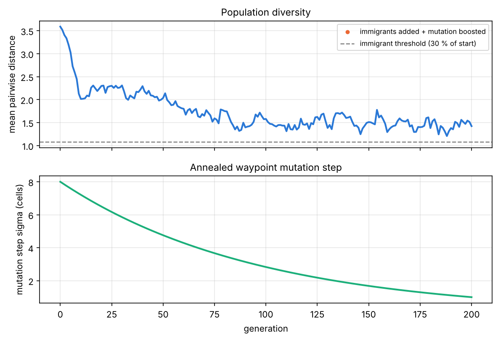
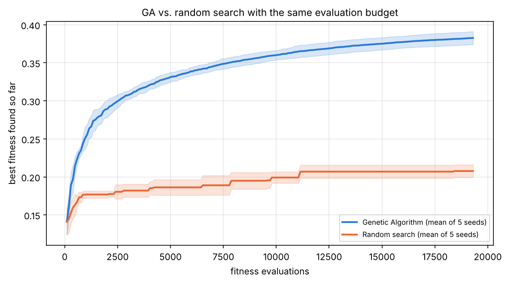
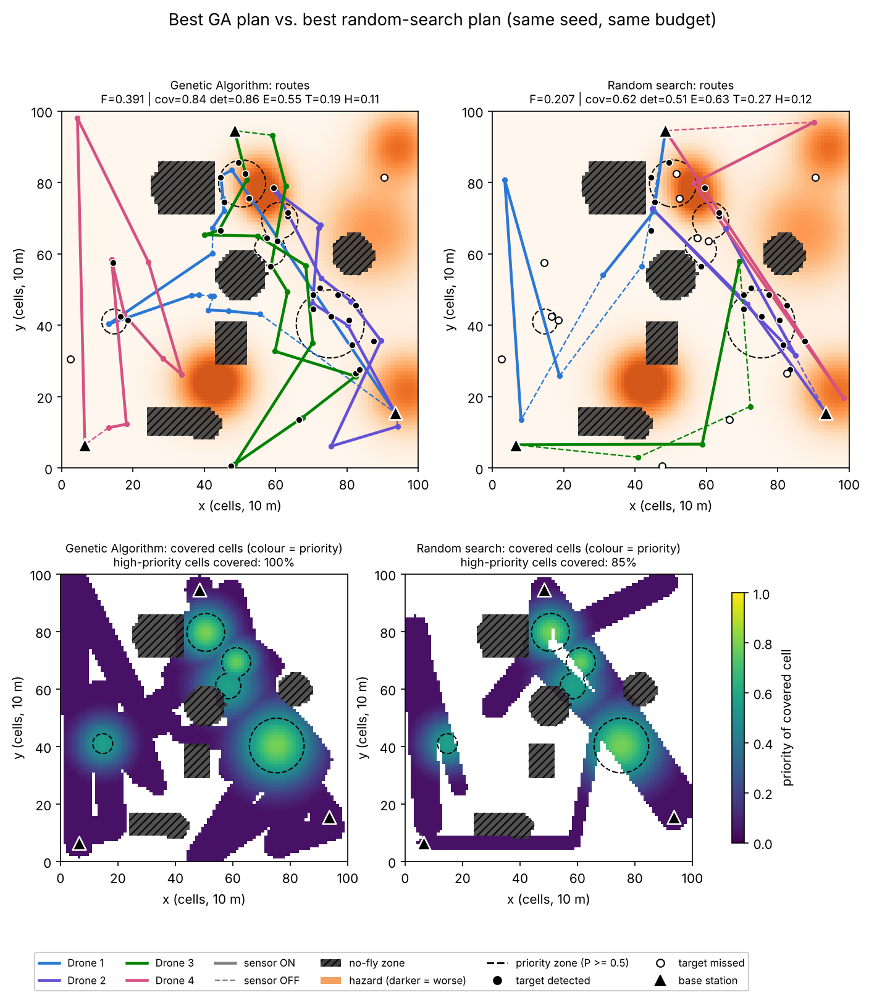

# UAV Fleet Strategy Engine with a Genetic Algorithm

**Artificial Intelligence – BSCS 5 · Assignment 2 · Department of Computer Science, Bahria University Lahore Campus**
**Author:** [Your Name] – [Roll No] (individual submission)

A Genetic Algorithm (GA), written from scratch in Python, that plans a fleet of **4 drones** surveying a
volatile **100 × 100 hazard grid**. It decides each drone's **launch base, waypoint route, speed on
every leg and sensor schedule (on/off + power)**, balancing five conflicting objectives:

* **maximise** priority-weighted coverage of disaster zones and the target detection rate,
* **minimise** energy use, mission time and exposure to wind/radiation hazard pockets,
* while respecting **hard constraints**: no-fly zones, 3 km range and 60 kJ battery per drone.


---

## Contents
1. [Features](#features)
2. [Repository structure](#repository-structure)
3. [Installation](#installation)
4. [How to run](#how-to-run)
5. [Configuration](#configuration)
6. [Chromosome and fitness function](#chromosome-and-fitness-function)
7. [Results](#results)
8. [Design decisions & assumptions](#design-decisions--assumptions)
9. [Tests](#tests)
10. [Author](#author)

## Features
* **Hybrid multi-segment chromosome** – integer base gene + real waypoints/speeds/sensor powers + binary sensor bits, variable length per drone.
* **Multi-objective fitness** – normalised weighted sum of 5 objectives + **dynamic penalty** that grows with the generation.
* **Realistic models** – rotary-wing UAV power model (Zeng et al., 2019), wind raises power use, detection depends on sensor power, distance and speed.
* **Constraint handling** – **repair** (BFS nearest free cell, side-point / divide-and-conquer / **A\*** detours, range & battery trimming) **and/or penalty** (`"repair"`, `"penalty"` or `"both"`).
* **Custom operators** – tournament / rank / roulette selection, elitism, drone-segment swap + BLX-α geometric crossover + uniform sensor-bit crossover, six spatial mutations with **annealed step size**.
* **Diversity control** – mean pairwise distance is tracked; random immigrants + mutation boost when it drops.
* **Termination** – max generations, stagnation or target fitness (the reason is logged).
* **Experiments** – main run, hyper-parameter sensitivity (5 sweeps × 3 seeds), GA vs. random search with the same evaluation budget (5 seeds).
* **Reproducible** – every run uses fixed seeds; the map is always generated from seed 7.
* **Colab notebook** – the full code cell by cell: [`UAV_GA_Colab.ipynb`](UAV_GA_Colab.ipynb).

## Repository structure
```
uav_ga/
  config.py          all settings as plain variables (grid, drones, weights, GA, experiments)
  environment.py     100x100 grid: no-fly zones, hazard field, priority map, targets, bases, BFS, A*
  chromosome.py      DroneSegment + Chromosome classes (the encoding)
  fitness.py         flight simulation, UAV energy model, coverage, detection, fitness + penalty
  constraints.py     repair operator (clip, move out of no-fly, detours, range/battery trimming)
  operators.py       selection, crossover and mutation
  ga.py              GeneticAlgorithm engine (elitism, diversity control, termination, history)
  baseline.py        random search with the same evaluation budget
  visualization.py   all plots
main.py              command-line entry point for all experiments
tests/               pytest unit tests
results/             generated figures, CSV and JSON (committed)
report/              Technical_Report.docx / .pdf and the script that builds them
UAV_GA_Colab.ipynb   the whole project as a Google Colab notebook
LEARNING_GUIDE.md    plain-English explanation of every file + viva questions
```

## Installation
Python 3.10 or newer.
```bash
git clone https://github.com/hariswasim617/AI-Assignment-2.git
cd AI-Assignment-2
python -m venv .venv
source .venv/bin/activate          # Windows: .venv\Scripts\activate
pip install -r requirements.txt
```

**Google Colab:** open `UAV_GA_Colab.ipynb` in Colab (`File → Open notebook → GitHub`) and choose
`Runtime → Run all`. No installation is needed.

## How to run
| Command | What it does | Time* |
|---|---|---|
| `python main.py --experiment all --quick` | whole pipeline with tiny settings (smoke test) | ~2 min |
| `python main.py` | main run: population 100, 200 generations, seed 42 → `results/` | ~2.5 min |
| `python main.py --experiment sensitivity` | 5 sweeps × 3 seeds × 100 generations → `results/sensitivity/` | ~1.5 h |
| `python main.py --experiment baseline` | GA vs. random search, 5 seeds → `results/baseline/` | ~40 min |
| `python main.py --experiment all` | all three experiments | ~2 h |
| `python main.py --seed 7 --generations 50 --pop-size 60` | a custom main run | – |
| `python report/build_report.py` | rebuilds the Word report from the results (+ PDF if LibreOffice is installed) | ~10 s |

\*measured on a 4-core cloud machine. `--quick` writes to `results_quick/` so it never overwrites the real results.

## Configuration
All settings live in [`uav_ga/config.py`](uav_ga/config.py) as plain, commented variables, grouped as:

| Group | Examples |
|---|---|
| World | `GRID_SIZE = 100`, `CELL_SIZE_M = 10`, `ENV_SEED = 7`, `N_NOFLY_ZONES = 7`, `N_TARGETS = 30`, `BASE_STATIONS` |
| Drones | `N_DRONES = 4`, `MAX_RANGE_M = 3000`, `BATTERY_J = 60000`, `V_MIN/V_MAX = 3/18 m/s`, sensor radius 1.5–5 cells |
| Chromosome | `K_INIT_MIN/MAX = 6/10`, `K_MIN/K_MAX = 2/14` |
| Fitness | `W_COVERAGE = 0.35`, `W_DETECTION = 0.25`, `W_ENERGY = 0.15`, `W_TIME = 0.10`, `W_HAZARD = 0.15`, `CONSTRAINT_MODE = "both"`, `PENALTY_START = 2`, `PENALTY_GROWTH = 4` |
| GA | `POP_SIZE = 100`, `GENERATIONS = 200`, `CROSSOVER_RATE = 0.9`, `MUTATION_RATE = 0.01`, `SELECTION = "tournament"`, `TOURNAMENT_K = 5` (both tuned by the sensitivity analysis), `ELITISM = 0.05`, `BLX_ALPHA = 0.3`, `SIGMA_START/END = 8/1`, `STAGNATION_PATIENCE = 60` |
| Experiments | `SWEEP_BASE_MUTATION_RATE = 0.1`, `SWEEP_BASE_TOURNAMENT_K = 3` (initial values the sweeps vary around), `SWEEP_SEEDS = [1, 2, 3]`, `SWEEP_GENERATIONS = 100`, the sweep values, `BASELINE_SEEDS = [1..5]` |

## Chromosome and fitness function
**Chromosome** – one segment per drone:
```
[ base | (x1, y1, v1, p1, a1) | (x2, y2, v2, p2, a2) | ... | (xK, yK, vK, pK, aK) ]
  int     real real real real bit
```
`base` = launch station index, `(x, y)` = waypoint, `v` = speed on the leg ending at that waypoint,
`p` = sensor power (radius 1.5–5 cells, 10–60 W), `a` = sensor on/off. The drone flies
`base → w1 → … → wK → base` (the return leg uses 14 m/s with the sensor off).

**Fitness** (maximised; every term normalised to 0..1):
```
F = 0.35·Coverage + 0.25·Detection − 0.15·Energy − 0.10·FlightTime − 0.15·Hazard − λ(g)·Violation
λ(g) = 2·(1 + 4·g/G)          Violation = 10·(no-fly share of path) + range overrun + battery overrun
```

## Results
All numbers below come from the committed files in [`results/`](results). The full analysis is in the
[technical report](report/Technical_Report.pdf).

### Main run (population 100, 200 generations, seed 42)
Stopped by: *max generations (200) reached* · 19,300 fitness evaluations · 138 s.

| Best plan | Generation 0 | Generation 200 |
|---|---|---|
| Fitness F | 0.150 | **0.381** |
| Coverage (priority-weighted) / detection rate | 0.550 / 0.393 | 0.832 / 0.869 |
| Targets detected · high-priority cells covered | – | 28 / 30 · 100 % |
| Energy share / flight-time share | 0.633 / 0.246 | 0.575 (138 kJ) / 0.196 (196 s) |
| Hazard exposure / constraint violation | 0.142 / 0 | 0.143 / 0 |

The average fitness rose from 0.016 to 0.335; diversity control added immigrants in 108 of 200 generations.

| Convergence (best vs. average ± std) | Diversity & annealed mutation step |
|---|---|
|  |  |

**Evolved flight paths across generations** (solid = sensor on, dashed = sensor off; routes bend around the hatched no-fly zones):


**Coverage heatmaps across generations** (top: best plan, colour = priority; bottom: share of the population covering each cell):


Other figures: [`objectives_over_time.png`](results/objectives_over_time.png), [`environment.png`](results/environment.png), [`final_solution.png`](results/final_solution.png); data: [`history.csv`](results/history.csv), [`run_summary.json`](results/run_summary.json).

### Hyper-parameter sensitivity (3 seeds × 100 generations, one parameter changed at a time around p_m = 0.1, k = 3)
| Setting | Final best F (mean ± std) | Gen. to 99 % | Final diversity | Evaluations | Runtime (s) | Feasible share |
|---|---|---|---|---|---|---|
| population 20 / 50 / 100 / 200 | 0.280 / 0.293 / 0.294 / **0.320** | 85 / 79 / 86 / 99 | 1.72 / 1.58 / 1.62 / 1.72 | 2,020 – 19,200 | 16 / 43 / 85 / 183 | 100 % |
| mutation rate 0.01 | **0.356 ± 0.006** | 95 | 1.22 | 9,700 | 74 | 100 % |
| mutation rate 0.05 | 0.326 ± 0.019 | 95 | 1.42 | 9,700 | 77 | 100 % |
| mutation rate 0.1 | 0.294 ± 0.005 | 86 | 1.62 | 9,700 | 83 | 100 % |
| mutation rate 0.2 | 0.273 ± 0.018 | 83 | 2.12 | 9,700 | 101 | 100 % |
| mutation rate 0.4 | 0.262 ± 0.004 | 75 | 2.58 | 9,700 | 121 | 100 % |
| tournament k = 2 / 3 / 5 / 8 | 0.295 / 0.294 / **0.326** / 0.325 | 89 / 86 / 94 / 97 | 2.04 / 1.62 / 1.49 / 1.42 | 9,700 | 94 / 85 / 82 / 83 | 100 % |
| roulette / rank / tournament | 0.268 / 0.272 / **0.294** | 88 / 92 / 86 | 2.35 / 2.43 / 1.62 | 9,700 | 102 / 103 / 83 | 100 % |
| constraints: penalty / repair / both | 0.264 ± 0.048 / **0.295** / 0.294 | 66 / 89 / 86 | 1.34 / 1.46 / 1.62 | 9,700 | 18 / 90 / 83 | 54 % / 100 % / 100 % |
| **combined: p_m = 0.01 and k = 5** | **0.364 ± 0.005** | – | – | 9,700 | 67 | – |

* **Mutation rate** has the biggest effect: with ~150–300 genes per chromosome, high rates destroy good routes (too much exploration).
* **Higher selection pressure** (k = 5–8) helps but lowers diversity; k = 8 has the largest spread between seeds.
* **Tournament** selection beats rank and roulette, which lose pressure when fitness values are close.
* **Repair** gives better, more stable and always-feasible results; penalty-only is 4–5× faster but leaves 46 % of the final population infeasible.
* The best two values together (p_m = 0.01, k = 5) beat either alone, so they are the final defaults in `config.py`.

Plots: [`sweep_pop_size.png`](results/sensitivity/sweep_pop_size.png), [`sweep_mutation_rate.png`](results/sensitivity/sweep_mutation_rate.png), [`sweep_tournament_k.png`](results/sensitivity/sweep_tournament_k.png), [`sweep_selection.png`](results/sensitivity/sweep_selection.png), [`sweep_constraint_mode.png`](results/sensitivity/sweep_constraint_mode.png); data: [`sensitivity_summary.csv`](results/sensitivity/sensitivity_summary.csv), [`sensitivity_runs.csv`](results/sensitivity/sensitivity_runs.csv), [`combined_check.csv`](results/sensitivity/combined_check.csv).

### GA vs. random search (5 seeds, 19,300 evaluations each, mean ± std)
| Best plan | Genetic Algorithm | Random search |
|---|---|---|
| Fitness F | **0.383 ± 0.010** | 0.208 ± 0.009 |
| Coverage (priority-weighted) | **0.831 ± 0.013** | 0.670 ± 0.039 |
| High-priority cells covered | **99.9 %** | 89.3 % |
| Detection rate | **0.856 ± 0.028** | 0.492 ± 0.042 |
| Targets detected (of 30) | **28.2 ± 0.8** | 16.2 ± 2.4 |
| Energy (kJ) | **134.2 ± 4.0** | 157.0 ± 15.9 |
| Makespan (s) | **199.9 ± 14.0** | 261.4 ± 22.6 |
| Hazard exposure | **0.123 ± 0.008** | 0.169 ± 0.033 |
| Constraint violation | 0 | 0 |
| Runtime per run (s) | 135 ± 7 | 371 ± 3 |

The GA wins on every metric and in every seed (worst GA seed 0.373 vs. best random seed 0.224). Its plans use many
short legs that sweep the disaster zones, keep the sensor on where it matters, and cross hazard pockets quickly,
while random plans are a few long straight legs that are cut short by the range limit.




## Design decisions & assumptions
* **One fixed world.** The map is generated from `ENV_SEED = 7` so all experiments are comparable; only the GA seeds change.
* **Units.** 1 cell = 10 m, so the map is 1 km × 1 km. Range 3 km and battery 60 kJ (≈17 Wh) per drone were chosen so that both limits are actually reached by long or slow routes.
* **Return to base is mandatory** and is not a gene: it always uses 14 m/s with the sensor off.
* **Sensors look straight down**; no-fly zones are airspace restrictions, not obstacles to the sensor's view.
* **Coverage** counts each cell once (seen or not seen) and weights it by its priority; no-fly cells have priority 0.
* **Detection** is the *expected* share of targets found (a smooth, deterministic quantity that is easier for the GA than a random yes/no); a target counts as "detected" in tables when its probability is ≥ 0.5.
* **Hazard exposure** is the time-weighted mean hazard intensity along all flights (dose per second of flight), so flying fast through a hazard pocket is better than flying slowly.
* **Repair is Lamarckian** – repaired genes are written back into the chromosome. Detour points inserted by repair become normal waypoints, so a route may temporarily have more than `K_MAX` waypoints; mutation never inserts beyond `K_MAX`.
* **Repair uses a 1-cell safety margin** around no-fly zones, while the fitness checks the real zones, so repaired routes never touch a no-fly cell.
* **Dynamic penalty in all modes except pure repair**, so the "repair" vs. "penalty" vs. "both" comparison in the sensitivity study is clean.
* **Fair baseline.** Random search uses the same random plan generator, repair and fitness (with the final penalty factor) and exactly as many fitness evaluations as the GA run with the same seed.
* **Sweeps run for a fixed 100 generations** (stagnation off) so that all settings of a sweep are compared at the same number of generations; the population-size sweep therefore also changes the number of evaluations (shown in the table).
* **Simplicity on purpose.** Plain functions instead of design-pattern classes, a plain-Python `config.py` instead of YAML, and no multiprocessing, so the code is easy to read and explain.

## Tests
```bash
pytest -q
```
14 tests check: valid map layers and connected airspace, valid random chromosomes, repair removes every
no-fly violation and respects range/battery, crossover and mutation keep genes in bounds and do not
change the parents, BLX-α interval, selection prefers fitter individuals, fitness terms in 0..1,
sensors-off gives zero coverage, the dynamic penalty grows, the power model is U-shaped and the GA is
reproducible with a fixed seed.

## Author
**[Your Name] – [Roll No]**, BSCS 5, Bahria University Lahore Campus. Individual submission.

See [`LEARNING_GUIDE.md`](LEARNING_GUIDE.md) for a plain-English walkthrough of the code and likely viva questions.
