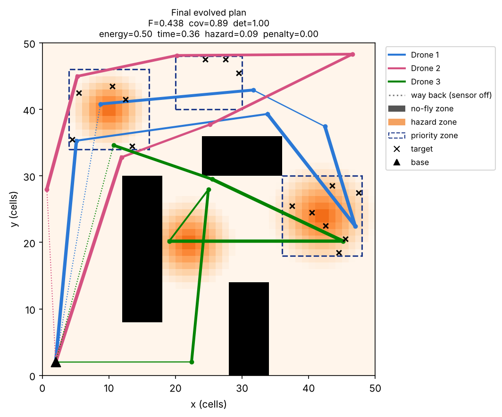
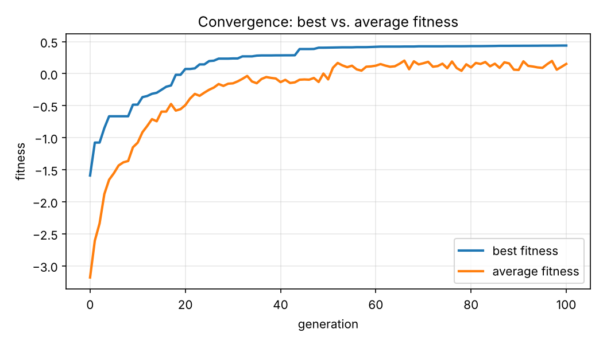
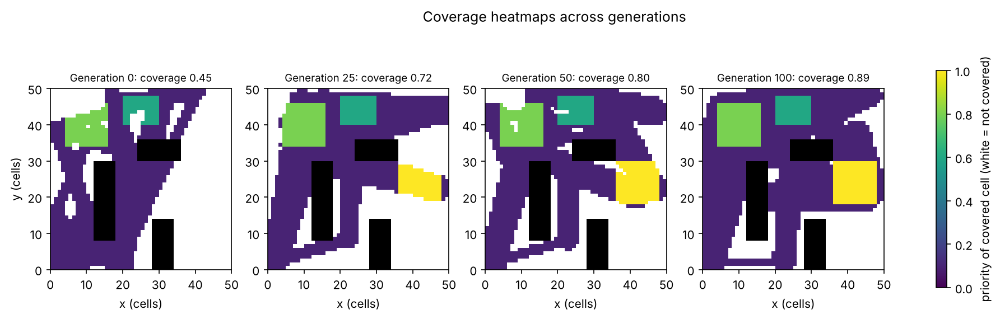
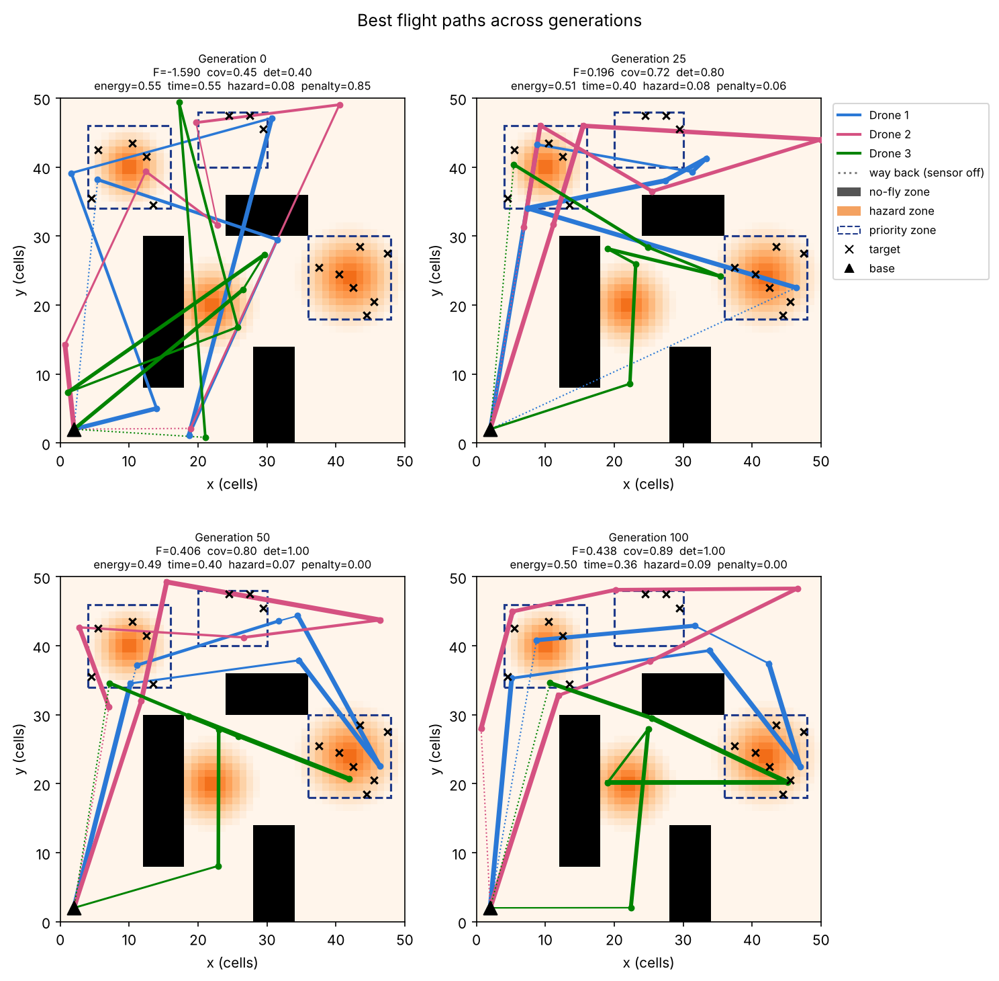
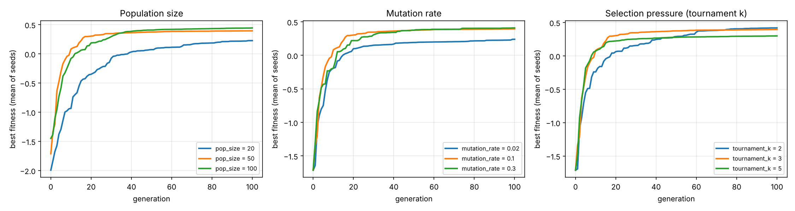
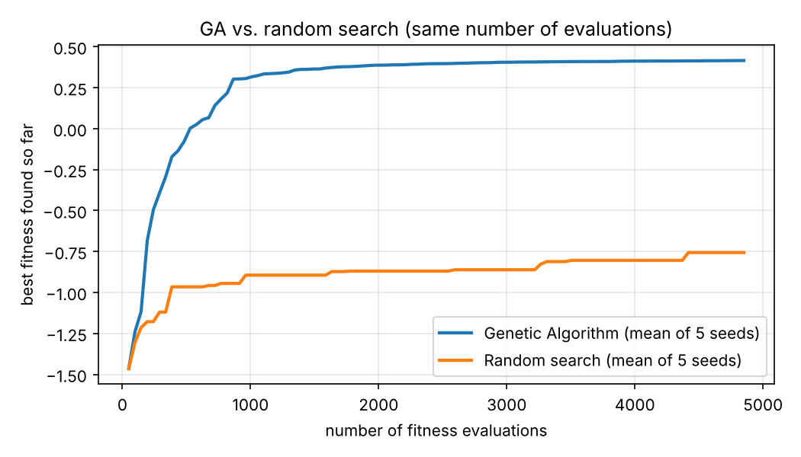
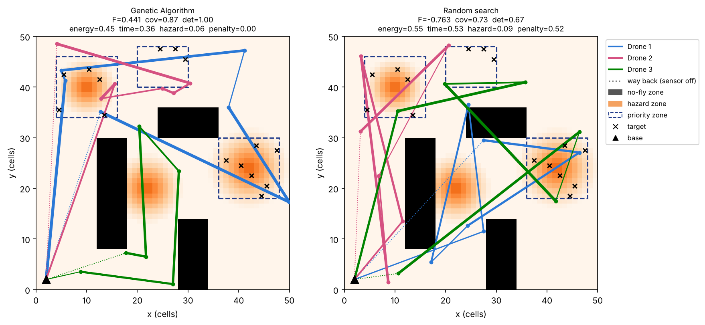

# UAV Fleet Planning with a Genetic Algorithm

**Artificial Intelligence – BSCS 5 · Assignment 2 · Bahria University Lahore Campus**
**Author:** [Your Name] – [Roll No]

A simple Genetic Algorithm (written from scratch in Python) that plans the routes, speeds and sensor
power of **3 drones** surveying a **50 x 50 disaster grid** with no-fly zones, hazard zones,
priority zones and targets.



## Files
| File | What it does |
|---|---|
| `config.py` | all settings (map, drones, fitness weights, GA settings) |
| `environment.py` | the grid: no-fly zones, hazard zones, priority zones, targets |
| `chromosome.py` | `Chromosome` class: waypoints (x, y), speed and sensor power for every drone |
| `fitness.py` | fitness function + constraint handling (repair and penalty) |
| `ga.py` | `GeneticAlgorithm` class: population, tournament selection, crossover, mutation, termination |
| `random_search.py` | baseline for comparison |
| `plots.py` | all figures |
| `main.py` | runs all experiments and saves the results in `results/` |
| `tests/test_ga.py` | 5 simple tests |
| `UAV_GA_Colab.ipynb` | the same code as Google Colab cells |
| `report/` | technical report (Word + PDF) and the script that makes it |
| `LEARNING_GUIDE.md` | simple explanation of the project + viva questions |

## How to run
```bash
python -m venv .venv
source .venv/bin/activate          # Windows: .venv\Scripts\activate
pip install -r requirements.txt

python main.py --quick             # quick test (~20 seconds)
python main.py                     # full experiments (~10 minutes) -> results/
pytest                             # run the tests
python report/make_report.py       # rebuild the report from the results
```
Or open `UAV_GA_Colab.ipynb` in Google Colab and click **Runtime → Run all**.

## How it works
**Chromosome** – one plan for the whole fleet: an array of shape (3 drones, 6 waypoints, 4 genes).
Each waypoint has `[x, y, speed, sensor_power]`. Every drone flies base → 6 waypoints → base.

**Fitness** (all parts scaled to 0..1):
```
F = 0.35*Coverage + 0.25*Detection - 0.15*Energy - 0.10*Time - 0.15*Hazard - 2*Penalty
```
* Coverage: priority-weighted share of cells inside a sensor circle (radius 1–4 cells, depends on sensor power)
* Detection: share of targets seen
* Energy: distance x (1 + 0.3*speed) + sensor power x time
* Time: flight time of the slowest drone
* Hazard: average hazard value under the path
* Penalty: flying through a no-fly zone or further than the maximum range

**Constraints** – repair (waypoints inside a no-fly zone move to the nearest open cell) + penalty.

**Operators** – tournament selection (k = 3), crossover = drone-segment swap + geometric blend,
mutation = Gaussian waypoint move + small speed/power change + waypoint swap, elitism (2), 2 random
immigrants per generation, stop after 100 generations or 30 generations without improvement.

## Results
**Main run** (population 50, 100 generations, seed 42): best fitness **-1.590 → 0.438**.
Final plan: coverage 0.89, 100% of targets found, no rules broken.

| Convergence | Coverage heatmaps across generations |
|---|---|
|  |  |



**Sensitivity analysis** (final best fitness, mean ± std over 3 seeds):

| Setting | Value 1 | Value 2 | Value 3 |
|---|---|---|---|
| Population size | 20: 0.226 ± 0.145 | 50: 0.394 ± 0.054 | 100: 0.443 ± 0.006 |
| Mutation rate | 0.02: 0.240 ± 0.028 | 0.1: 0.394 ± 0.054 | 0.3: 0.409 ± 0.003 |
| Tournament k | 2: 0.418 ± 0.008 | 3: 0.394 ± 0.054 | 5: 0.298 ± 0.099 |



**GA vs. random search** (same number of evaluations, 5 seeds):

| | GA | Random search |
|---|---|---|
| Fitness | **0.415 ± 0.050** | -0.756 ± 0.119 |
| Coverage | 0.888 ± 0.023 | 0.665 ± 0.071 |
| Detection | 1.000 ± 0.000 | 0.667 ± 0.140 |
| Penalty | 0.011 ± 0.023 | 0.509 ± 0.045 |




## Assumptions
* The map is fixed (same zones and targets in every run) so all runs can be compared.
* Sensors look straight down; no-fly zones block flying, not seeing.
* On the way back to the base the drone flies at full speed with the sensor off.
* Energy and sensor models are simple formulas, not real drone data.
